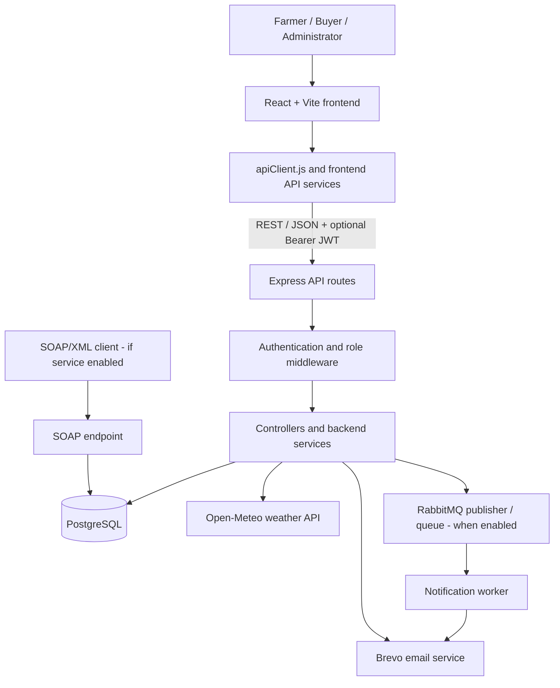

# ARDNET Source Code: Structure, Communication and Logic Flow

This guide explains how the ARDNET frontend, backend, database, and optional integrations fit together. It is intended to accompany a complete snapshot of the original ARDNET project inside `FMPEX/ARDNET_Source_Code/`.

**Documentation scope:** File roles and flows below reflect the architecture established during ARDNET development. Exact route names, filenames, and implementation status must be checked against the uploaded source code; this document is not an automatic audit of the current checkout.

## 1. Architecture overview

Communication is mostly request-response over HTTP with JSON. The notification pipeline adds asynchronous messaging when the queue/worker is running.

## 2. Frontend folders and responsibilities

| Location | Responsibility |
|---|---|
| `src/main.jsx` | React entry point; mounts the app and its global providers. |
| `src/App.jsx` | Route declarations, page layouts, and role-gated route groups. |
| `src/api/apiClient.js` | Shared HTTP request logic and authorization headers. |
| `src/api/config.js` | API base URL and endpoint configuration. |
| `src/api/services/` | Feature-specific request methods (for example auth, listings, market, alerts, weather, favorites/comments). |
| `src/components/` | Shared buttons, cards, dialogs, icons and reusable UI. |
| `src/context/` | Theme and other cross-component contexts. |
| `src/features/` | Components grouped by functional area. |
| `src/hooks/` | Reusable state and data-fetching hooks. |
| `src/layout/` | Public pages, authenticated dashboards and shared shells. |
| `src/pages/` | Screens mapped to routes such as home, login, listings and dashboards. |
| `src/redux/` | Global Redux store and slices for authentication and listings. |
| `src/styles/` | SCSS and visual styles. |
| `src/utils/` | Formatting, constants and storage helpers. |

Some components depend on providers declared in `main.jsx`; for example, a theme control may fail at runtime when rendered outside its theme provider. When consolidating this frontend with another React project, reconcile the providers and Redux store instead of copying individual pages alone.

## 3. Backend folders and responsibilities

| Location | Responsibility |
|---|---|
| `src/server.js` | Creates and starts Express; mounts routes and common middleware. |
| `src/routes/` | Defines HTTP endpoint paths and their middleware/controller mappings. |
| `src/controllers/` | Validates requests, executes application logic, and returns responses. |
| `src/middleware/auth.js` | Checks JWTs and enforces configured role permissions. |
| `src/config/database.js` | Creates/manages the PostgreSQL connection pool. |
| `src/services/` | Shared services, including email, notification, broker, and reconciliation code where present. |
| `migrations/` | Schema evolution and database setup scripts. |
| `scripts/` | Developer and maintenance commands. |
| `tests/` | Automated tests where provided. |
| `examples/` | Example payloads or demonstrations, including SOAP-related samples where available. |

The server previously exposed APIs for authentication, market prices, produce listings, alerts, weather, and administrative tasks. Exact routes can be found in `src/routes/` and their registration in `src/server.js`.

## 4. Main application workflows

### A. Registration, login and protected screens

1. A user enters information in a React authentication form.
2. The frontend authentication service calls `/api/auth/register` or `/api/auth/login`.
3. The Express authentication controller validates input, applies password hashing/verification, and accesses PostgreSQL user/role tables.
4. On successful login, the frontend stores the returned session details and JWT according to its authentication implementation (historically the token key was `ardnet.token`).
5. Subsequent protected API calls include the token in the `Authorization: Bearer ...` header.
6. Backend middleware validates the token and roles. Frontend protected routes also guide navigation, but **backend authorization is the security boundary**.
7. Email verification and password recovery use separate authentication endpoints and may send email through Brevo; verify their current status before testing.

### B. Produce listing workflow

1. A farmer opens the listing form.
2. The frontend submits the listing through the listings API service.
3. The backend verifies authentication and the farmer role before persisting data.
4. Listing data is stored in tables such as `produce_listings`, with related category/photo records where supported.
5. Buyers and other permitted users retrieve public listings through the API.

### C. Market-price reference workflow

1. The frontend requests market-price records using the market service.
2. Express market routes delegate to market controllers and PostgreSQL.
3. Public users read market-price references, while administrator-only operations modify prices when enabled.
4. Any SOAP/XML market-information endpoint is separate from the REST/JSON client flow; check the code for its actual URL, operations and readiness.

### D. Alerts and notifications

1. Users define alert preferences and target price conditions.
2. Backend services store alerts and evaluate relevant price changes.
3. When the RabbitMQ pipeline is enabled, the backend publishes a price-alert event to the configured exchange/queue.
4. A notification worker consumes an event, creates or updates a notification record, and calls Brevo for email delivery.
5. Retry and dead-letter behavior depend on the worker and RabbitMQ configuration; they should be tested independently.

### E. Weather information

1. A frontend page or hook requests weather data from the backend.
2. The backend weather controller/service queries Open-Meteo.
3. The backend returns the selected results to the frontend for display.

## 5. Database organization

The ARDNET relational design has used these core tables:

- `roles`, `users`, `auth_tokens`
- `produce_categories`, `produce_listings`, `produce_photos`
- `market_prices`, `price_alerts`, `notifications`, `audit_logs`

During development, a restoration test database was used in place of a production database. **Do not upload production credentials or raw user-data backups** as part of this source-code transfer. Coordinate the target database/schema with your partner.

## 6. API communication and errors

- Frontend APIs generally send and receive JSON.
- Protected requests include a JWT, which the backend verifies.
- Role checks are performed on the server regardless of whether a page is hidden in the frontend.
- Backend errors should be exposed in a controlled response and surfaced by the frontend without exposing internal secrets.
- Browser CORS configuration and backend port must match the development environment.

## 7. Starting and testing the system

1. Install project dependencies in `ARDNET_Backend` and `ARDNET_Frontend` (normally `npm install`).
2. Provision the PostgreSQL schema and local, secret environment configuration.
3. Start the backend (historically `node src/server.js` from `ARDNET_Backend`).
4. Start the React frontend (`npm run dev` from `ARDNET_Frontend`).
5. Test registration/login, role navigation, CRUD operations, market prices, alerts and notifications.
6. If using RabbitMQ, Docker, SOAP, or Brevo, test each integration with the required services configured.
7. Run `npm run build` in the frontend to catch compilation issues, **then browser-test runtime behavior**; a successful build alone does not prove full functionality.

## 8. Collaboration notes

The FMPEX GitHub repository may also contain an older React app under `ArdNet/`. This uploaded ARDNET snapshot intentionally lives under a **different** folder (`ARDNET_Source_Code/`) so neither codebase is overwritten. Before deploying, agree on the canonical frontend entry point and backend configuration.

## 9. Security checklist before pushing

- Keep `.env`, `.env.local`, `.env.production`, credentials, SSH keys and API tokens out of Git.
- Keep `node_modules/`, `dist/`, coverage and generated content out of Git.
- Keep `package.json` **and** lockfiles in Git for installation and reproducibility.
- Inspect staged filenames using `git diff --cached --name-only`.
- Audit source/config files for accidentally hardcoded tokens and passwords.
- Confirm database backups or seeded data contain no private records.
